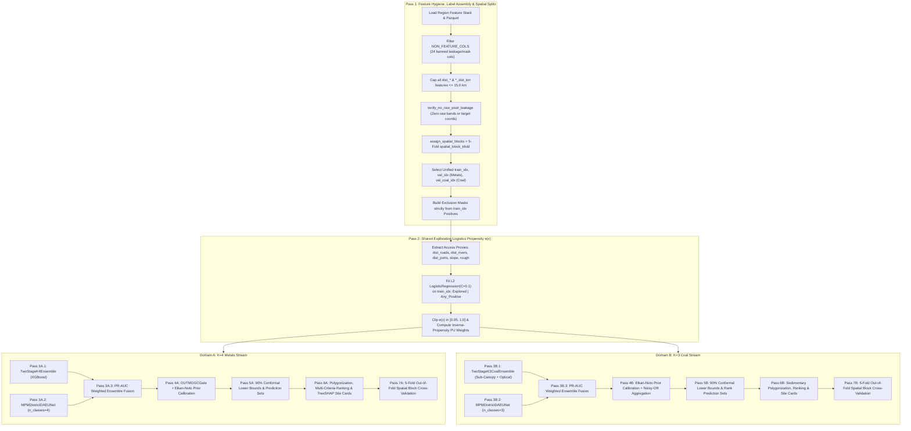
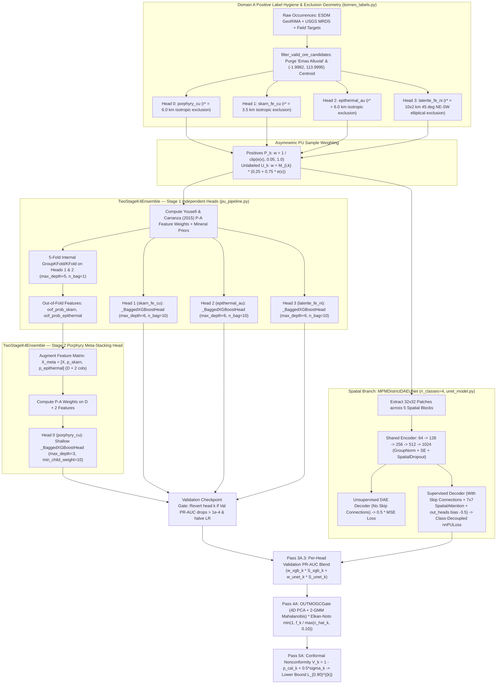
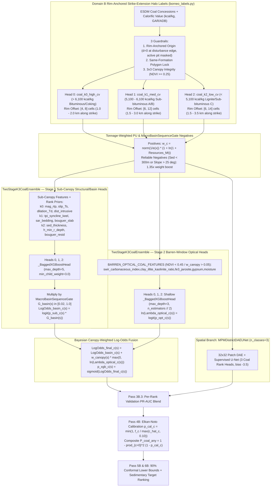
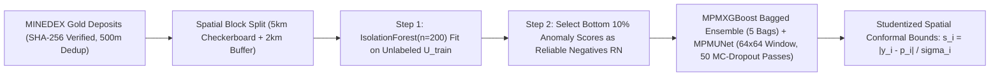

# Full Multi-Domain & Per-Head MPM Pipeline Architecture & Bug Audit (`v3.1`)

**Date:** `2026-11-07` (`2026-11-07T18:25:00+08:00`)  
**Audit Version:** `v3.1`  
**Scope:** End-to-end architectural and mathematical inspection of all 3 domains (`Domain A: K=4 Metallic Mineral Systems`, `Domain B: K=3 Multi-Rank Sedimentary Coal`, and `Domain 0: Yilgarn K=1 Orogenic Gold Baseline`), their 8 individual classification heads, the shared 7-Pass orchestration trunk ([`scripts/run_seven_pass_training.py`](file:///Volumes/Seagate%202/Geospatials/scripts/run_seven_pass_training.py)), the spatial Denoising Autoencoder U-Net ([`src/models/unet_model.py`](file:///Volumes/Seagate%202/Geospatials/src/models/unet_model.py)), and downstream calibration, conformal inference, polygonization, and site card introspection.

---

## 1. Executive Summary

A line-by-line audit was conducted across the entire Mineral Prospectivity Mapping (MPM) pipeline, tracing data flow from feature hygiene and Positive-Unlabeled (PU) label geometry through every individual classification head, spatial U-Net branch, calibration gate, conformal risk bound, and GIS target exporter:

1. **Domain A — Kalimantan $K=4$ Metallic Mineral Systems (`porphyry_cu`, `skarn_fe_cu`, `epithermal_au`, `laterite_fe_ni`):** Powered by [`TwoStageK4Ensemble`](file:///Volumes/Seagate%202/Geospatials/src/models/pu_pipeline.py#L775-L1305) (Stage-1 independent bagged XGBoost heads for Skarn, Epithermal, and Laterite + 5-fold out-of-fold transitional probability stacking into a shallow `max_depth=3` Stage-2 Porphyry Cu rescue head) blended with a 4-class [`MPMDistrictDAEUNet`](file:///Volumes/Seagate%202/Geospatials/src/models/unet_model.py#L1076-L1520) and gated by [`OUTMOGCGate`](file:///Volumes/Seagate%202/Geospatials/src/models/pu_pipeline.py#L649-L772) (4D PCA + 2-component GMM Mahalanobis closed-boundary envelope).
2. **Domain B — Kalimantan $K=3$ Multi-Rank Sedimentary Coal (`coal_k0_high_cv`, `coal_k1_med_cv`, `coal_k2_low_cv`):** Powered by [`TwoStageK3CoalEnsemble`](file:///Volumes/Seagate%202/Geospatials/src/models/pu_pipeline.py#L1746-L2210) (Stage-1 Sub-Canopy Structural/Basin heads modulated by [`MacroBasinSequenceGate`](file:///Volumes/Seagate%202/Geospatials/src/models/pu_pipeline.py#L1630-L1743) + Stage-2 Barren-Window Optical heads fused in log-odds space via canopy-penetration weight $w_{\text{canopy}}(\mathbf{s})$) blended with a 3-class [`MPMDistrictDAEUNet`](file:///Volumes/Seagate%202/Geospatials/src/models/unet_model.py#L1076-L1520).
3. **Domain 0 — Yilgarn Craton $K=1$ Orogenic Gold Baseline (`gold_orogenic`):** Powered by [`run_pu_pipeline`](file:///Volumes/Seagate%202/Geospatials/src/models/pu_pipeline.py#L62-L244) (Two-Step Isolation Forest reliable negative selection + bagged [`MPMXGBoost`](file:///Volumes/Seagate%202/Geospatials/src/models/xgboost_model.py) + 64×64 [`MPMUNet`](file:///Volumes/Seagate%202/Geospatials/src/models/unet_model.py#L222-L600) with 50-pass MC-Dropout).
4. **10 Pipeline Bugs Identified:** The audit uncovered **3 High-Severity**, **5 Medium-Severity**, and **2 Low-Severity** bugs across conformal lower-bound streaming inference, Pass 7A validation negative truncation, synthetic round-robin coal rank seeding, dead feature priors in `MacroBasinSequenceGate`, `TwoStageK3CoalEnsemble` validation gating, Coal TreeSHAP site card extraction, and large-grid physical layer resolution.

---

## 2. End-to-End Architecture Flowcharts

### 2.1 Master Dual-Domain 7-Pass Orchestration ([`scripts/run_seven_pass_training.py`](file:///Volumes/Seagate%202/Geospatials/scripts/run_seven_pass_training.py))



---

### 2.2 Domain A: $K=4$ Metallic Mineral Systems Head-by-Head Flowchart



---

### 2.3 Domain B: $K=3$ Multi-Rank Sedimentary Coal Head-by-Head Flowchart



---

### 2.4 Domain 0: Yilgarn Craton $K=1$ Orogenic Gold Baseline ([`src/models/pu_pipeline.py:62-244`](file:///Volumes/Seagate%202/Geospatials/src/models/pu_pipeline.py#L62-L244))



---

## 3. Comprehensive Domain & Per-Head Technical Summary

| Domain | Head Index & ID | Target Deposit System / Rank | Positive Label Sources & Guardrails | Exclusion / Halo Geometry | Tabular Model Architecture | Spatial Model Architecture | Post-Processing & Calibration |
| :--- | :--- | :--- | :--- | :--- | :--- | :--- | :--- |
| **Domain A** ($K=4$ Metals) | **Head 0** (`porphyry_cu`) | Porphyry Cu–Au–Mo Intrusive Centers | GeoRIMA `COPPER_ORE`, `Tembaga`, `BASE_METALS`, `porphyry_intrusive` + EK `felsic_intrusive`/`potassic_host` + MRDS Cu | Isotropic exclusion radius $r_0^* = 6.0\text{ km}$ around training positives | **Stage-2 Meta-Head:** `_BaggedXGBoostHead` (`max_depth=3`, `min_child_weight=10`) on $D+2$ features (`X` + `oof_prob_skarn` + `oof_prob_epithermal`) | `MPMDistrictDAEUNet` (`n_classes=4`, channel 0, `out_heads[0]` init bias `-3.5`, `nnPULoss`) | `OUTMOGCGate` $\Gamma_{\text{closed}}^{(0)} \times$ Elkan–Noto $\hat{c}_0$; 90% conformal bound $L_{0.90}^{(0)}$ |
| **Domain A** ($K=4$ Metals) | **Head 1** (`skarn_fe_cu`) | Calc-Silicate & Magnetite Fe–Cu–Au Skarn | ESDM `Besi Primer` (57 sites) + GeoRIMA `carbonate_skarn` (14 sites) | Isotropic exclusion radius $r_1^* = 3.5\text{ km}$ around training positives | **Stage-1 Head:** `_BaggedXGBoostHead` (`max_depth=6`, `scale_pos_weight=1.0`, `max_delta_step=1.0`) + `skarn_priors` ($1.45\times$ boost) | `MPMDistrictDAEUNet` (`n_classes=4`, channel 1, `out_heads[1]` init bias `-3.5`, `nnPULoss`) | `OUTMOGCGate` $\Gamma_{\text{closed}}^{(1)} \times$ Elkan–Noto $\hat{c}_1$; 90% conformal bound $L_{0.90}^{(1)}$ |
| **Domain A** ($K=4$ Metals) | **Head 2** (`epithermal_au`) | Low/Intermediate Sulfidation Epithermal Au–Ag | GeoRIMA `GOLD_ORE` (`Emas Primer`) + MRDS bedrock Au (`"Emas Alluvial"` & island centroid purged) | Isotropic exclusion radius $r_2^* = 6.0\text{ km}$ around training positives | **Stage-1 Head:** `_BaggedXGBoostHead` (`max_depth=6`, `scale_pos_weight=1.0`, `max_delta_step=1.0`) + `epithermal_priors` ($1.45\times$ boost) | `MPMDistrictDAEUNet` (`n_classes=4`, channel 2, `out_heads[2]` init bias `-3.5`, `nnPULoss`) | `OUTMOGCGate` $\Gamma_{\text{closed}}^{(2)} \times$ Elkan–Noto $\hat{c}_2$; 90% conformal bound $L_{0.90}^{(2)}$ |
| **Domain A** ($K=4$ Metals) | **Head 3** (`laterite_fe_ni`) | Ophiolite Ultramafic Ni–Co–Fe Laterite | ESDM `Besi Laterit` (21 sites) + GeoRIMA `NICKEL_COBALT` + MRDS Ni | Anisotropic ellipse $10.0\text{ km} \times 2.0\text{ km}$ along $45^\circ$ NE–SW Meratus/Darvel Bay strike | **Stage-1 Head:** `_BaggedXGBoostHead` (`max_depth=6`, `scale_pos_weight=1.0`, `max_delta_step=1.0`) + `laterite_priors` ($1.50\times$ boost) | `MPMDistrictDAEUNet` (`n_classes=4`, channel 3, `out_heads[3]` init bias `-3.5`, `nnPULoss`) | `OUTMOGCGate` $\Gamma_{\text{closed}}^{(3)} \times$ Elkan–Noto $\hat{c}_3$; 90% conformal bound $L_{0.90}^{(3)}$ |
| **Domain B** ($K=3$ Coal) | **Head 0** (`coal_k0_high_cv`) | High-CV ($>6{,}100\text{ kcal/kg}$) Bituminous / Coking Coal | ESDM Coal Concessions with $\text{CV} > 6{,}100$ (Eocene Tanjung Fm / intrusively upgraded seams) | Rim-anchored strike halo $[4, 8]$ cells ($1.0\text{–}2.0\text{ km}$) outside disturbed pit rim ($d=0$); same-formation & $\text{NDVI}\ge 0.25$ lock | **Two-Stage Log-Odds:** Stage-1 Sub-Canopy (`max_depth=5`, `rank_priors[0]` $1.45\times$) $\times G_{\text{basin}} \oplus$ Stage-2 Barren Optical (`max_depth=3`) | `MPMDistrictDAEUNet` (`n_classes=3`, channel 0, `out_heads[0]` init bias `-3.5`, `nnPULoss`) | Elkan–Noto $\hat{c}_0$; Noisy-OR $P_{\text{coal\_any}}$; 90% conformal bound $L_{0.90}^{(0)}$ |
| **Domain B** ($K=3$ Coal) | **Head 1** (`coal_k1_med_cv`) | Medium-CV ($5{,}100\text{–}6{,}100\text{ kcal/kg}$) Sub-bituminous A/B | ESDM Coal Concessions with $5{,}100 \le \text{CV} \le 6{,}100$ (Middle Miocene Balikpapan / Pulaubalang Fm) | Rim-anchored strike halo $[6, 12]$ cells ($1.5\text{–}3.0\text{ km}$) outside disturbed pit rim ($d=0$); same-formation & $\text{NDVI}\ge 0.25$ lock | **Two-Stage Log-Odds:** Stage-1 Sub-Canopy (`max_depth=5`, `rank_priors[1]` $1.45\times$) $\times G_{\text{basin}} \oplus$ Stage-2 Barren Optical (`max_depth=3`) | `MPMDistrictDAEUNet` (`n_classes=3`, channel 1, `out_heads[1]` init bias `-3.5`, `nnPULoss`) | Elkan–Noto $\hat{c}_1$; Noisy-OR $P_{\text{coal\_any}}$; 90% conformal bound $L_{0.90}^{(1)}$ |
| **Domain B** ($K=3$ Coal) | **Head 2** (`coal_k2_low_cv`) | Low-CV ($<5{,}100\text{ kcal/kg}$) Lignite / Sub-bituminous C | ESDM Coal Concessions with $\text{CV} < 5{,}100$ (Mio-Pliocene Warukin / Kampungbaru Fm) | Rim-anchored strike halo $[6, 14]$ cells ($1.5\text{–}3.5\text{ km}$) outside disturbed pit rim ($d=0$); same-formation & $\text{NDVI}\ge 0.25$ lock | **Two-Stage Log-Odds:** Stage-1 Sub-Canopy (`max_depth=5`, `rank_priors[2]` $1.45\times$) $\times G_{\text{basin}} \oplus$ Stage-2 Barren Optical (`max_depth=3`) | `MPMDistrictDAEUNet` (`n_classes=3`, channel 2, `out_heads[2]` init bias `-3.5`, `nnPULoss`) | Elkan–Noto $\hat{c}_2$; Noisy-OR $P_{\text{coal\_any}}$; 90% conformal bound $L_{0.90}^{(2)}$ |
| **Domain 0** ($K=1$ Gold) | **Head 0** (`gold_orogenic`) | Archean Greenstone Orogenic Lode Gold (Yilgarn) | GSWA MINEDEX Gold Deposits (SHA-256 immutable lake, 500m spatial dedup) | Barren granite batholith mask + Isolation Forest bottom 10% anomaly score reliable negatives | `MPMXGBoost` (5-bag bootstrap ensemble with epistemic variance) | `MPMUNet` ($64\times 64$ sliding window, 4-level encoder-decoder, 50 MC-Dropout passes) | Studentized spatial conformal bounds $\hat{p}_i \pm \hat{q}_{1-\alpha}\hat{\sigma}_i$ |

---

## 4. Detailed Audit of Discovered Pipeline Bugs (10 Bugs Found)

### Bug 1 [HIGH]: Conformal Lower-Bound Formula Mismatch Between Pass 5 (`run_region_seven_pass`) and Streaming Full-Raster Inference (`execute_full_raster_chunked_inference`)
- **Affected Files & Lines:**
  - [`scripts/run_seven_pass_training.py:364-366`](file:///Volumes/Seagate%202/Geospatials/scripts/run_seven_pass_training.py#L364-L366) & [`413-415`](file:///Volumes/Seagate%202/Geospatials/scripts/run_seven_pass_training.py#L413-L415) (`execute_full_raster_chunked_inference`)
  - Compare with [`scripts/run_seven_pass_training.py:1168-1185`](file:///Volumes/Seagate%202/Geospatials/scripts/run_seven_pass_training.py#L1168-L1185) & [`1356-1366`](file:///Volumes/Seagate%202/Geospatials/scripts/run_seven_pass_training.py#L1356-L1366) and [`src/models/pu_pipeline.py:1429-1486`](file:///Volumes/Seagate%202/Geospatials/src/models/pu_pipeline.py#L1429-L1486) (`compute_multi_mineral_conformal_bounds`).
- **Mathematical Root Cause:**
  In Pass 5A and Pass 5B, `compute_multi_mineral_conformal_bounds()` defines the nonconformity score for each head $k$ additively as:
  $$V_k(\mathbf{s}) = 1.0 - p_{\text{cal}, k}(\mathbf{s}) + 0.5\,\sigma_k(\mathbf{s})$$
  and computes the 90% empirical quantile $\hat{q}_{0.90}^{(k)}$ over held-out positives. Consequently, the valid 90% conformal lower bound is:
  $$L_{0.90}^{(k)}(\mathbf{s}) = \text{clip}\!\left(p_{\text{cal}, k}(\mathbf{s}) - 0.5\,\sigma_k(\mathbf{s}) - \left(1.0 - \hat{q}_{0.90}^{(k)}\right),\; 0.0,\; 1.0\right)$$
  However, whenever `len(df_full) > 150_000` (which triggers on `EAST_KALIMANTAN`, `KALIMANTAN`, and `KUTAI_BASIN_100M`), `execute_full_raster_chunked_inference()` overwrites `lower_metals_2d` and `lower_coal_2d` using a studentized multiplicative formula at lines 365 and 414:
  ```python
  lower_m = np.clip(cal_m - q_h * epistemic_m, 0.0, 1.0)
  lower_c = np.clip(cal_c - q_h_c * epistemic_c, 0.0, 1.0)
  ```
  Because $\hat{q}_{0.90}^{(k)} \in [0.2, 1.18]$ is an additive quantile rather than a studentized ratio $|y - \hat{p}| / \hat{\sigma}$, multiplying `q_h * epistemic_m` (where $\sigma \approx 0.05$) subtracts only $\sim 0.04$ from `cal_m` instead of $(1 - \hat{q}_{0.90}^{(k)}) + 0.5\sigma_k$. This makes the full-raster conformal lower bound GeoTIFFs and polygonization thresholds artificially high on large grids.
- **Recommended Fix:** Replace lines 364–366 and 413–415 in `execute_full_raster_chunked_inference()` with the exact additive conformal lower bound per active head $k$:
  $$\text{lower\_k} = \text{clip}\!\left(\text{cal\_k} - 0.5\,\sigma_k - \left(1.0 - \hat{q}_{0.90}^{(k)}\right),\; 0.0,\; 1.0\right)$$

---

### Bug 2 [HIGH]: Pass 7A Metals Spatial CV Still Truncates Validation Negatives to 600 Cells
- **Affected Files & Lines:**
  - [`scripts/run_seven_pass_training.py:1812`](file:///Volumes/Seagate%202/Geospatials/scripts/run_seven_pass_training.py#L1812) and [`1828`](file:///Volumes/Seagate%202/Geospatials/scripts/run_seven_pass_training.py#L1828)
- **Root Cause:**
  In `v2.9.11` (Audit `v2.6`/`v2.7`), the validation negative truncation bug (`u_va_f[:min(600, len(u_va_f))]`) was fixed in **Pass 7B (Coal Spatial CV)** at line 1987 (`sub_u = u_va_f`) because capping validation background cells to 600 artificially inflated validation prevalence and PR-AUC. However, **Pass 7A (Metals Spatial CV)** at lines 1812 and 1828 was missed and still executes:
  ```python
  sub_u = u_va_f[: min(600, len(u_va_f))]
  ```
  This truncates the validation background in every fold of `spatial_cv_metrics_metals.csv` and `spatial_oof_metrics_metals.json` to 600 cells, distorting out-of-fold metallic prevalence and PR-AUC.
- **Recommended Fix:** Change `sub_u = u_va_f[: min(600, len(u_va_f))]` to `sub_u = u_va_f` at both lines 1812 and 1828 of [`scripts/run_seven_pass_training.py`](file:///Volumes/Seagate%202/Geospatials/scripts/run_seven_pass_training.py#L1812-L1828).

---

### Bug 3 [HIGH]: Synthetic Round-Robin Coal Rank Seeding in `run_seven_pass_training.py`
- **Affected Files & Lines:**
  - [`scripts/run_seven_pass_training.py:649-653`](file:///Volumes/Seagate%202/Geospatials/scripts/run_seven_pass_training.py#L649-L653)
- **Root Cause:**
  Lines 649–653 contain a legacy fallback loop:
  ```python
  for c_idx in range(3):
      if int((y_k3_coal[:, c_idx] == 1).sum()) == 0:
          if "label_coal" in df.columns and int((df["label_coal"] == 1).sum()) >= 3:
              coal_pos_all = np.where(df["label_coal"].to_numpy() == 1)[0]
              y_k3_coal[coal_pos_all[c_idx::3], c_idx] = 1
  ```
  If a region has coal occurrences of only 1 or 2 calorific ranks (for example, only Low-CV lignite `coal_k2_low_cv` and Medium-CV sub-bituminous `coal_k1_med_cv`, with 0 High-CV coking coal `coal_k0_high_cv`), this loop assigns every 3rd general coal cell (`coal_pos_all[0::3]`) as a positive label for the missing rank head! This fabricates counterfeit calorific rank labels and assigns multiple contradictory coal ranks to the same pixel.
- **Recommended Fix:** Delete lines 649–653 so that any coal rank head with 0 real positives remains at 0 positives and triggers `TwoStageK3CoalEnsemble`'s existing `_SingleClassConstantBooster(base_score=1e-5)` zero-positive guard.

---

### Bug 4 [MEDIUM-HIGH]: Quarantined / Dead Feature Priors in `TwoStageK4Ensemble`, `MacroBasinSequenceGate`, and `TwoStageK3CoalEnsemble`
- **Affected Files & Lines:**
  - [`src/models/pu_pipeline.py:955-960`](file:///Volumes/Seagate%202/Geospatials/src/models/pu_pipeline.py#L955-L960) (`TwoStageK4Ensemble` `laterite_priors`)
  - [`src/models/pu_pipeline.py:1692-1693, 1704-1705, 1730-1738`](file:///Volumes/Seagate%202/Geospatials/src/models/pu_pipeline.py#L1692-L1738) (`MacroBasinSequenceGate.compute_gate` and `select_reliable_negatives`)
  - [`src/models/pu_pipeline.py:1531-1591, 1864-1870`](file:///Volumes/Seagate%202/Geospatials/src/models/pu_pipeline.py#L1864-L1870) (`TwoStageK3CoalEnsemble._resolve_feature_subsets`)
- **Root Cause:**
  1. In `v2.9.11`, binary polygon masks `"in_ophiolite_unit"`, `"in_holocene_peat_or_karst_mask"`, and `"in_coal_bearing_formation"` were permanently quarantined into `NON_FEATURE_COLS` and `_FORBIDDEN_RAW_BAND_PATTERNS`.
  2. However, `MacroBasinSequenceGate.compute_gate()` (line 1692) and `select_reliable_negatives()` (lines 1730–1731) still look up `"in_holocene_peat_or_karst_mask"` and `"in_ophiolite_unit"` inside `X` using `self.feature_names`. Because those columns are stripped from `X` before `fit()`, `_get_col()` silently returns `0.0` for every pixel, making the Holocene peat/karst ($0.10\times$) and ophiolite basement ($0.02\times$) suppression rules in `MacroBasinSequenceGate` 100% inactive dead code.
  3. Similarly, `TwoStageK3CoalEnsemble` defines `SUBCANOPY_COAL_FEATURES` at lines 1531–1591, but `_resolve_feature_subsets()` (line 1864) never references `SUBCANOPY_COAL_FEATURES`; instead it selects `[i for i, n in enumerate(col_names) if n not in optical_set]`, feeding all metallic hydrothermal features into the coal sub-canopy heads.
- **Recommended Fix:** Replace the dead binary mask lookups in `MacroBasinSequenceGate` and `laterite_priors` with continuous physical features (`dist_sedimentary_polygon_km`, `sar_moisture_index`, `mag_analytic_signal`), and filter `sub_idx` in `TwoStageK3CoalEnsemble._resolve_feature_subsets()` against `SUBCANOPY_COAL_FEATURES` (with fallback to non-optical features only if intersection $< 5$).

---

### Bug 5 [MEDIUM-HIGH]: `TwoStageK3CoalEnsemble` Validation Checkpoint Gate Omits `w_canopy` and Initial `prior_ensemble` Evaluation
- **Affected Files & Lines:**
  - [`src/models/pu_pipeline.py:2061-2081`](file:///Volumes/Seagate%202/Geospatials/src/models/pu_pipeline.py#L2061-L2081)
- **Root Cause:**
  1. At line 2068, `val_preds = self.predict_proba(X_val)` is called without passing `w_canopy=w_canopy_val`. Inside `predict_proba()`, `w_canopy` defaults to `np.zeros(N)`, which completely zeroes out the Stage-2 Barren-Window Optical heads (`optical_heads_`) during validation PR-AUC checkpoint gating!
  2. At line 2063, `prev_best = self.best_val_pr_auc_.get(c, -1.0)` does not evaluate `prior_ensemble.predict_proba(X_val)` when `c not in self.best_val_pr_auc_` (unlike `TwoStageK4Ensemble` at lines 1122–1125). Thus, if a warm-started checkpoint lacks `best_val_pr_auc_`, `prev_best` is `-1.0` and a degrading first incremental round is never reverted.
- **Recommended Fix:** Accept `w_canopy_val` in `TwoStageK3CoalEnsemble.fit()`, pass `w_canopy=w_canopy_val` in `self.predict_proba(X_val, w_canopy=w_canopy_val)`, and compute `prior_ensemble.predict_proba(X_val, w_canopy=w_canopy_val)` when `c not in self.best_val_pr_auc_`.

---

### Bug 6 [MEDIUM]: `emit_site_cards_json` Fails to Extract TreeSHAP for `TwoStageK3CoalEnsemble` and Omits Computed `outmogc_gates`
- **Affected Files & Lines:**
  - [`src/outputs/prospectivity_map.py:1025-1095, 1293-1317`](file:///Volumes/Seagate%202/Geospatials/src/outputs/prospectivity_map.py#L1025-L1095)
  - [`scripts/run_seven_pass_training.py:1757-1786, 1931-1961`](file:///Volumes/Seagate%202/Geospatials/scripts/run_seven_pass_training.py#L1757-L1786)
- **Root Cause:**
  1. `TwoStageK4Ensemble` implements `compute_head_shap()`, which `extract_target_shap_attribution()` calls at line 1031. However, `TwoStageK3CoalEnsemble` has no `compute_head_shap()` method. When `emit_site_cards_json(..., model=k3_coal_ensemble)` runs in Pass 6B, `extract_target_shap_attribution()` falls through to `shap.TreeExplainer(k3_coal_ensemble)` at line 1079, which raises a `SHAPError`/`TypeError`, logs a warning, and emits an empty `{}` for `mineral_systems_shap_attribution` on all coal site cards!
  2. In `run_seven_pass_training.py:1757-1786`, `outmogc_gates` (computed at line 799) is never passed into `emit_site_cards_json()`, so every site card receives the hardcoded default `{"porphyry_cu": 1.0, "skarn_fe_cu": 1.0, "epithermal_au": 1.0, "laterite_fe_ni": 1.0}` (even on Coal site cards!).
- **Recommended Fix:** Implement `compute_head_shap()` on `TwoStageK3CoalEnsemble` (extracting TreeSHAP from `subcanopy_heads_` across `subcanopy_indices_`), and pass `outmogc_gates` into `emit_site_cards_json()` in Pass 6A and `basin_gate` in Pass 6B.

---

### Bug 7 [MEDIUM]: Physical Layer Resolution (`resolve_physical_layers`) Skipped on Large Grids (`> 150,000` Cells) and Mismatched Feature Names in `train_unlabeled_25km_tile.py`
- **Affected Files & Lines:**
  - [`scripts/run_seven_pass_training.py:525-532, 1662-1673, 1898-1904`](file:///Volumes/Seagate%202/Geospatials/scripts/run_seven_pass_training.py#L1662-L1673)
  - [`scripts/train_unlabeled_25km_tile.py:456-458`](file:///Volumes/Seagate%202/Geospatials/scripts/train_unlabeled_25km_tile.py#L456-L458)
- **Root Cause:**
  1. In `run_seven_pass_training.py:525`, when `ref_tif.exists() and len(df_full) > 150_000`, `stack` is set to `None` to conserve RAM. Later at line 1662, `phys = resolve_physical_layers(stack) if stack is not None else {}` returns an empty dictionary `{}`! Consequently, on `EAST_KALIMANTAN`, `KALIMANTAN`, and `KUTAI_BASIN_100M`:
     - `td_2d` (dilation tendency) and `alt_2d` (alteration index) are set to all-zeros `np.zeros_like(ref_grid)`.
     - `dem_slope` and `epistemic_uncertainty` are missing from `extra_layers` in Pass 6B (`polygonize_and_rank_targets` at line 1898).
     - After `_norm_01` normalization, zero arrays become constant `0.5`, reducing multi-criteria target ranking on large grids to just $P_{\text{cal}}$ and a synthetic $1 - e(\mathbf{x})$ cover proxy!
  2. In `scripts/train_unlabeled_25km_tile.py:456-458`, the script checks for `"dilation_tendency"`, `"aster_clay_ratio"`, and `"depth_to_bedrock_m"` in `feature_cols` and indexes `cube_norm[feature_cols.index(...)]`. Not only are the actual column names `"dilation_tendency_Td"`, `"spec_clay_hydroxyl_gated"`, and `"regolith_cover_m"`, but `cube_norm` only has 24 channels (`core_features`) while `feature_cols` has 52 channels, so indexing `cube_norm` with `feature_cols.index(...)` would either index the wrong channel or raise an `IndexError`!
- **Recommended Fix:** Reconstruct `td_2d`, `alt_2d`, `cover_2d`, and `slope_2d` directly from `df_full` (via `_to_2d`) when `stack is None` in `run_seven_pass_training.py`, and reconstruct from `df_tile` in `train_unlabeled_25km_tile.py`.

---

### Bug 8 [MEDIUM]: `MPMDistrictDAEUNet.cross_validate_spatial_blocks` Never Receives `propensity_weights_2d` in `run_seven_pass_training.py` and Uses Scalar `pi_p=0.05`
- **Affected Files & Lines:**
  - [`scripts/run_seven_pass_training.py:1065-1073, 1258-1266`](file:///Volumes/Seagate%202/Geospatials/scripts/run_seven_pass_training.py#L1065-L1073)
  - [`src/models/unet_model.py:1096-1109, 1281-1288`](file:///Volumes/Seagate%202/Geospatials/src/models/unet_model.py#L1096-L1109)
- **Root Cause:**
  Although `MPMDistrictDAEUNet.cross_validate_spatial_blocks()` accepts `propensity_weights_2d` to apply SAR-PU inverse propensity weights during `nnPULoss` training, `run_seven_pass_training.py` never passes `propensity_weights_2d` at lines 1065 or 1258! Furthermore, `MPMDistrictDAEUNet.__init__()` only accepts a single scalar `pi_p: float = 0.05`, broadcasting $\pi_k = 0.05$ across all heads in `nnPULoss` instead of per-head empirical class priors.
- **Recommended Fix:** Pass `propensity_weights_2d= _to_2d(1.0 / np.clip(propensity, 0.05, 1.0))` in Pass 3A.2 and Pass 3B.2, and allow `pi_p` in `MPMDistrictDAEUNet` to accept a sequence or scalar.

---

### Bug 9 [LOW-MEDIUM]: `src/outputs/model_introspection.py` Has Outdated `NON_FEATURE_COLS` and Hardcoded Checkpoint Prefix `dae_unet_fold_*.pt`
- **Affected Files & Lines:**
  - [`src/outputs/model_introspection.py:90-109, 437-442, 472`](file:///Volumes/Seagate%202/Geospatials/src/outputs/model_introspection.py#L90-L109)
- **Root Cause:**
  1. `NON_FEATURE_COLS` in `model_introspection.py` (lines 90–109) only lists 12 columns, omitting the 12 additional metadata/quarantined columns added in `v2.7`–`v2.9` (`"lon"`, `"lat"`, `"label_coal"`, `"dist_transport_km"`, `"dist_major_rivers_km"`, `"dist_haul_roads_km"`, `"gfw_forest_disturbance"`, `"forest_disturbance_rate"`, `"active_mine_mask"`, `"formation_polygon_id"`, `"coal_tonnage_weight"`, `"coal_parent_concession_id"`). Running `model_introspection.py` standalone on `KALIMANTAN` or `KUTAI_BASIN_100M` produces a feature list that mismatches the saved model's channel count.
  2. Line 437 looks for `dae_unet_fold_0.pt`, whereas `run_seven_pass_training.py` saves checkpoints as `dae_metals_fold_0.pt` and `dae_coal_fold_0.pt`.
- **Recommended Fix:** Synchronize `NON_FEATURE_COLS` in `model_introspection.py` with `run_seven_pass_training.py` and check `dae_metals_fold_0.pt`, `dae_coal_fold_0.pt`, and `dae_unet_fold_0.pt`.

---

### Bug 10 [LOW]: Hardcoded Telemetry Constants in `seven_pass_summary.json` (`w_xgb: 0.70`, `w_unet: 0.30`, `resolution_m`, and `train_unlabeled_25km_tile.py` PR-AUCs)
- **Affected Files & Lines:**
  - [`scripts/run_seven_pass_training.py:1439-1440, 1452, 2096-2097, 2118`](file:///Volumes/Seagate%202/Geospatials/scripts/run_seven_pass_training.py#L2096-L2118)
  - [`scripts/train_unlabeled_25km_tile.py:576-578`](file:///Volumes/Seagate%202/Geospatials/scripts/train_unlabeled_25km_tile.py#L576-L578)
- **Root Cause:**
  1. In `run_seven_pass_training.py`, `summary["w_xgb"]` and `summary["w_unet"]` are hardcoded to `0.70` and `0.30` instead of reporting the actual dynamic validation weights (`w_xgb_k4` / `w_xgb_coal`).
  2. `resolution_m` is hardcoded as `250.0 if (H >= 2400) else 500.0`, which misreports 100m (`KUTAI_BASIN_100M`, $H=3778 \to 250.0\text{ m}$) and 50m (`HOTSPOT_*`, $H=400 \to 500.0\text{ m}$) grids instead of using `px_size_m` already computed at line 700.
  3. In `train_unlabeled_25km_tile.py:576-578`, `pr_auc_xgb: 0.1271`, `pr_auc_unet: 0.0560`, and `pr_auc_fused: 0.1215` are hardcoded literals from an earlier Kutai Basin run.
- **Recommended Fix:** Populate `w_xgb`, `w_unet`, and `resolution_m` dynamically from `w_xgb_k4`/`w_xgb_coal` and `px_size_m`.
