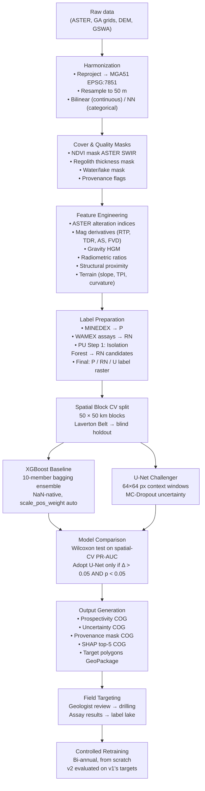

# Mineral Prospectivity Mapping — System Design & Evidence Base

**Pilot:** Orogenic Gold · Eastern Goldfields Superterrane · Yilgarn Craton, WA
**Prediction unit:** 50 × 50 m cells · GDA2020 / MGA Zone 51 (EPSG:7851)
**Model framing:** Positive-Unlabeled (PU) learning
**Primary metric:** Precision-Recall AUC (spatial block CV)

---

## Part 1 — Feasibility & Data Audit

### Why a Global 50 m System Is Not Currently Feasible

| Blocker | Detail |
|---|---|
| **Geophysics coverage** | Global magnetic grids (EMAG2) are ~3.7 km resolution — 74× coarser than the target cell. High-res airborne surveys are national/regional, not global. |
| **Label precision** | USGS MRDS coordinates are often ±1–5 km. At 50 m cells, a 1 km offset places a known deposit 400 cells away from its true signature. |
| **Vegetation and cover** | ASTER SWIR fails under tropical canopy, boreal forest, and glacial till — >40% of Earth's land surface. |
| **ASTER SWIR failure** | The ASTER SWIR detector failed in April 2008. All SWIR-based alteration mapping is limited to pre-2008 archive data. |

**Verdict:** Global coverage requires a minimum of national-level, open-access, high-resolution geophysics and sub-100 m drillhole coordinates. The Yilgarn Craton in Western Australia satisfies all these criteria under open licences.

### Pilot Data Sources — Confirmed Availability

| Dataset | Native Resolution | Licence | Key Limitation |
|---|---|---|---|
| ASTER L2 (AST_07XT) | 15 m VNIR / 30 m SWIR / 90 m TIR | Open (US Gov) | SWIR data only pre-April 2008 |
| Sentinel-2 L2A | 10–60 m | Copernicus CC 3.0 | No SWIR > 2.2 µm; cannot resolve clay species |
| GA Aeromagnetics (TMI, RTP) | 80 m grid | CC BY 4.0 | Multi-vintage; line-tie errors at survey edges |
| GA Radiometrics (K/U/Th) | 100 m grid | CC BY 4.0 | Penetration ~45 cm; blind to covered mineralisation |
| GA Gravity (Bouguer) | 400 m grid | CC BY 4.0 | 8× below-resolution — upsampled with explicit flag |
| AW3D30 DEM (JAXA) | 30 m | Free (reg. required) | Minimal vegetation bias in Yilgarn |
| GSWA Geology 1:500k | 1:500 000 | CC BY 4.0 | Polygon boundaries generalised at 50 m scale |
| MINEDEX deposits | Point (±10–500 m) | CC BY 4.0 | Historical records may lack decimal precision |
| WAMEX drillholes | Point (±10–100 m) | CC BY-NC 4.0 | Non-commercial licence — verify before commercialisation |

> [!CAUTION]
> **ASTER SWIR data is irreplaceable for argillic/phyllic alteration mapping.** It cannot be substituted by Sentinel-2. All SWIR-based features must be flagged in the provenance mask when the pre-2008 archive tile is unavailable for a given cell.

---

## Part 2 — Prediction Unit & Labels

### Why 50 m Cells?

| Input | Native resolution | Justification for 50 m target |
|---|---|---|
| ASTER VNIR | 15 m | Upsampled — fine, minimal information loss |
| ASTER SWIR | 30 m | Upsampled — moderate, acceptable with bilinear |
| Sentinel-2 | 10–20 m | Upsampled/downsampled — acceptable |
| Aeromagnetics | 80 m | Downsampled — **information loss**; mark with resolution flag |
| Radiometrics | 100 m | Downsampled — same caveat |
| Gravity | 400 m | Downsampled 8× — **interpolation flag mandatory** |
| DEM | 30 m | Upsampled — acceptable |
| Geology | 1:500k | Rasterised — coarse boundaries; use only as categorical context |

50 m is scientifically justified for imagery and terrain derivatives. **It is not justified to claim 50 m spatial fidelity for radiometrics or gravity** — those layers carry neighbourhood-scale information dressed in fine-pixel clothing. The provenance mask communicates this to end users.

### PU Label Framing

Standard binary classification (deposit = 1, everything else = 0) is **fundamentally flawed** for MPM:
- Unlabelled ground is not demonstrated to be barren.
- Exploration is biased toward known camps — the spatial distribution of drillholes is not random.
- Treating U as negative produces a model that learns "stay away from unexplored ground," not one that generalises to it.

```
P  (Positive)             — Confirmed economic deposits (≥100 koz Au, drill-verified)
RN (Reliable Negative)    — ≥3 holes, ≥50 m depth in greenstone, best assay <0.05 g/t Au
U  (Unlabeled)            — Everything else: unknown, not barren
```

The **two-step PU approach** (Liu et al. 2003; Mordelet & Vert 2014):
1. Train an Isolation Forest on P vs. random U → scores U cells by anomalousness
2. U cells with the *lowest* anomaly scores (most "normal") become the RN set
3. Train final classifier on P + new RN

---

## Part 3 — Modeling Workflow



### Missing Data Policy

> [!IMPORTANT]
> **Never impute geophysical missing values with the column mean.** Mean imputation silently assigns a "typical" geophysical signature to unexplored ground, which biases the model toward predicting average geology as prospective.
>
> - XGBoost: pass `missing=np.nan` — the algorithm handles NaN natively via split direction.
> - U-Net: use a learnable mask embedding channel (binary, 1 = valid, 0 = missing) concatenated to the input window.
> - Cells where >50% of features are NaN are masked out of predictions entirely and flagged in the provenance layer.

---

## Part 4 — Leakage-Resistant Evaluation

### Why Random Splits Are Invalid

Geological features are spatially autocorrelated. A magnetic high anomaly extends over tens of kilometres; an alteration halo can span 5 km. A randomly split training/test set will have near-identical geology on both sides of the split boundary. The model will appear to generalise but is actually interpolating memorised local geography.

> [!WARNING]
> **Do not report random-split accuracy as evidence of generalisation.** A model with 98% random-split accuracy may have 30% accuracy on a new mining district it has never seen.

### Evaluation Design

```
┌─────────────────────────────────────────────────────────────┐
│                      Pilot AOI (~600 × 400 km)              │
│                                                             │
│  ┌──────┬──────┬──────┬──────┬──────┬──────┬──────┐        │
│  │  B1  │  B2  │  B3  │  B4  │  B5  │  B6  │  B7  │        │
│  ├──────┼──────┼──────┼──────┼──────┼──────┼──────┤        │
│  │  B8  │  B9  │ B10  │ B11  │ B12  │ B13  │ B14  │        │
│  └──────┴──────┴──────┴──────┴──────┴──────┴──────┘        │
│                                                             │
│  ████████████████  LAVERTON BELT  ███████████████          │
│  ←————————————— BLIND HOLDOUT (never seen during CV) ————→  │
└─────────────────────────────────────────────────────────────┘
  Each B_i = 50 × 50 km spatial block
  5-fold CV: 4 blocks train, 1 block val, rotate
```

### Metrics

| Metric | Why this metric | Limitation |
|---|---|---|
| **PR-AUC** (primary) | Focuses on the rare positive class; not inflated by the large U majority | Requires knowing true negatives — use RN as proxy |
| ROC-AUC | Reported for comparison only | Severely optimistic under class imbalance |
| Recall @ FPR 10% | Practical: how many deposits found before drilling 10% false-positive ground | FPR denominator includes U cells (imperfect) |
| NDCG@100 | Ranking quality: are the top-100 prospectivity cells worth drilling? | Assumes top-100 is a realistic targeting budget |

---

## Part 5 — Feature Set & Mineral Systems Rationale

| Feature | Component | Source | Geoscientific Rationale |
|---|---|---|---|
| `aster_aloh_content` | Deposition | ASTER SWIR B5,B6,B7 | Al-OH absorptions at 2.2 µm → sericite/muscovite (phyllic alteration) proximal to Au-quartz veins |
| `aster_carbonate_chlorite` | Deposition | ASTER SWIR B6-B9 | Carbonate + chlorite → propylitic alteration distal halo |
| `aster_ferric_oxide` | Deposition | ASTER VNIR B1,B2 | Fe3+ (gossans, limonite) → supergene expression of sulphide oxidation |
| `aster_silica_tir` | Deposition | ASTER TIR B11,B13 | Silicification → quartz veining |
| `s2_clay_index` | Deposition | S2 B11/B12 | Coarse clay proxy (cannot resolve species) |
| `mag_rtp` | Source/Transport | GA Aeromagnetics | Magnetite-destructive alteration → demagnetisation halos around deposits |
| `mag_tdr` | Structural (Trap) | GA Aeromagnetics | Zero-contour maps contacts/faults; positive = magnetic body |
| `mag_analytic_signal` | Source | GA Aeromagnetics | Total field amplitude; highlights mafic-ultramafic packages (source rocks) |
| `dist_major_fault_m` | Trap | GA + GSWA faults | Orogenic gold deposits cluster within 1–2 km of major crustal shear zones |
| `dist_fault_intersection_m` | Trap | derived | Second-order fault intersections = dilational jogs → preferred Au precipitation sites |
| `grav_hgm` | Source | GA Gravity | Density contrasts → granite-greenstone boundaries (rheological traps) |
| `k_pct` | Source | GA Radiometrics | K enrichment → alteration of mafic host rocks; potassic halos around some deposits |
| `th_u_ratio` | Source | GA Radiometrics | High Th/U → mafic affinity (greenstone belts); low → granitic sources |
| `tpi_200m` | Transport/Trap | AW3D30 DEM | Topographic position correlates with paleo-drainage and structural highs |
| `slope_deg` | Structural texture | AW3D30 DEM | Steep slopes = erosional exposure of bedrock; low slopes = covered/transported material |
| `flow_accumulation_log` | Transport | AW3D30 DEM | Drainage networks as proxies for structural lineaments |

---

## Part 6 — Field Validation & Retraining Protocol

### Targeting Workflow

```
v1 prospectivity map
        ↓
Target polygons (score ≥ 0.70, uncertainty ≤ 0.20, area ≥ 25 ha)
        ↓
Geologist review: rank by score + geological reasonableness
        ↓
Field mapping → rock chip sampling → RC/diamond drilling
        ↓
Assay results reviewed by licensed geologist (reviewer_id required)
        ↓
Verified results → immutable label lake (parquet, append-only)
        ↓
Bi-annual retraining (from scratch, not fine-tuning)
```

### Anti-Feedback-Loop Guarantee

```python
# In RetrainingPipeline.load_label_lake():
if (label_lake['label_source'] == 'ai_prediction').any():
    raise ValueError(
        "CRITICAL: Label lake contains rows with label_source='ai_prediction'. "
        "AI predictions must NEVER become training labels. "
        "Review and remove these rows before retraining."
    )
```

### Model Version Comparison Protocol

| Step | Action |
|---|---|
| Deploy v1 | Generate targets; record target polygon IDs and coordinates |
| v1 field season | Drill v1 targets; standardise assays into label lake |
| Retrain v2 | From scratch using P + RN + U including new assays |
| Evaluate v2 | Predict on the exact drillhole locations tested by v1 |
| Compare | v2 PR-AUC on v1 drillholes vs. v1 PR-AUC on v1 drillholes |
| Changelog | Auto-generated: label delta, metric delta, new targets added |

---

## Part 7 — Compute & Storage Estimates

| Parameter | Value | Notes |
|---|---|---|
| AOI area | ~240 000 km² | Eastern Goldfields window |
| Total 50 m cells | ~96 billion | Most are ocean/salt lake/deep cover |
| Active greenstone cells | ~40 million | Filtered by geology mask |
| Feature matrix (float32) | ~12 GB | 40M × 18 features × 4 bytes |
| Training subset | 10% sample | ~4M cells; sufficient for XGBoost |
| U-Net input windows | 64×64×18 | ~512 KB per window; train on random sample |
| Inference (XGBoost) | ~2–5 min | On 40M cells, 8-core CPU |
| Inference (U-Net) | ~30–60 min | On 40M windows, A10 GPU |
| Output COG storage | ~600 MB | 4 × float32 bands × 40M cells |
| Recommended hardware | 8-core CPU, 64 GB RAM, 500 GB SSD | GPU optional for U-Net |

---

## Part 8 — Success Criteria

> [!NOTE]
> These are the measurable, pre-registered criteria for declaring the pilot successful. They must be agreed before seeing test data.

| Criterion | Target | Measurement |
|---|---|---|
| Spatial-CV PR-AUC (XGBoost) | ≥ 0.30 | 5-fold spatial block CV on Yilgarn (excluding Laverton holdout) |
| Blind holdout PR-AUC | ≥ 0.25 | Laverton Belt, never seen during training |
| Recall @ FPR 10% | ≥ 0.50 | At least 50% of known deposits retrieved before 10% false positive ground drilled |
| Target polygon hit rate (v1→v2) | ≥ 30% | Fraction of v1 high-score targets confirmed as mineralised by field/drill data |
| SHAP explanation consistency | Qualitative | SHAP top feature must align with known deposit-type controls (Au → sericite alteration + fault proximity) |

> [!CAUTION]
> Failing to reach these targets does **not** mean the approach is wrong — it may mean the label set is too small, the geophysics is insufficient, or the pilot region is geologically more complex than expected. Failure should trigger a **data gap analysis**, not model complexity escalation.

---

## References

1. Groves, D.I., Goldfarb, R.J., Gebre-Mariam, M., Hagemann, S.G., & Robert, F. (1998). Orogenic gold deposits: A proposed classification in the context of their crustal distribution and relationship to other gold deposit types. *Ore Geology Reviews*, 13(1–5), 7–27.
2. Roberts, D.R. et al. (2017). Cross-validation strategies for data with temporal, spatial, hierarchical, or phylogenetic structure. *Ecography*, 40(8), 913–929. https://doi.org/10.1111/ecog.02881
3. Rowan, L.C. & Mars, J.C. (2003). Lithologic mapping in the Mountain Pass, California area using Advanced Spaceborne Thermal Emission and Reflection Radiometer (ASTER) data. *Remote Sensing of Environment*, 84(3), 350–366.
4. Hewson, R.D. et al. (2005). Earthquake-induced changes in minerals on the southern flank of Mt. Etna. *Remote Sensing of Environment*, 95(1), 44–56.
5. Ninomiya, Y. (2002). A stabilized vegetation index and several mineralogic indices defined for ASTER SWIR data. *IEEE IGARSS 2002*.
6. Mordelet, F. & Vert, J.P. (2014). A bagging SVM to learn from positive and unlabeled examples. *Pattern Recognition Letters*, 37, 201–209.
7. Liu, B., Dai, Y., Li, X., Lee, W.S., & Yu, P.S. (2003). Building text classifiers using positive and unlabeled examples. *IEEE ICDM 2003*.
8. Witt, W.K., Ford, A., Hanrahan, B., & Mamuse, A. (2013). Regional-scale targeting for gold in the Yilgarn Craton: part 1 of the Yilgarn Gold Exploration Targeting Atlas. *GSWA Report 122*.
9. Horn, B.K.P. (1981). Hill shading and the reflectance map. *Proceedings of the IEEE*, 69(1), 14–47.
10. Evans, I.S. (1980). An integrated system of terrain analysis and slope mapping. *Zeitschrift für Geomorphologie*, Supplementband 36, 274–295.
